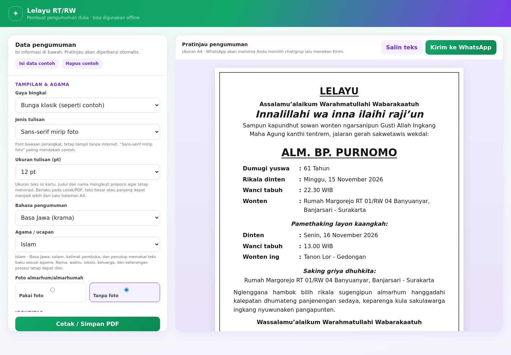
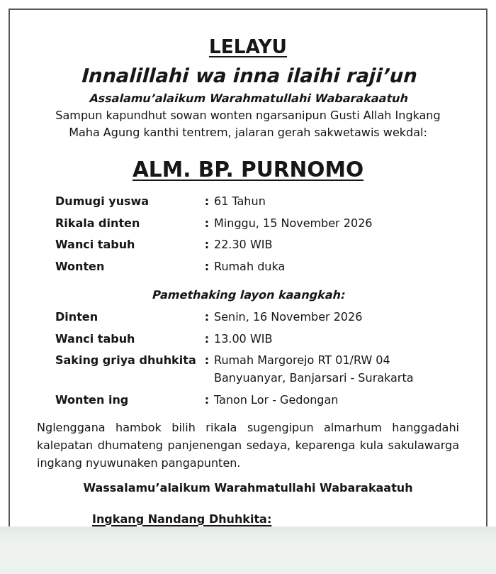
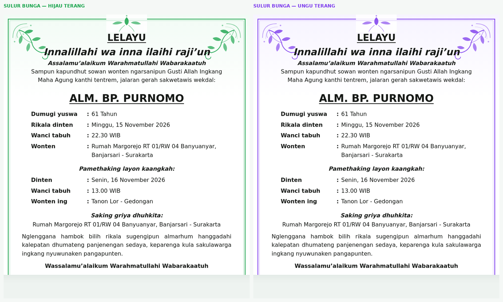

<div align="center">


# Lelayu RT/RW — Pembuat Pengumuman Duka

Aplikasi web (PWA) untuk membuat pengumuman lelayu/duka cita siap cetak A4 —
Basa Jawa (krama) maupun Bahasa Indonesia. Berjalan **sepenuhnya offline**, tanpa server, tanpa akun.

</div>



## Fitur

- **Dua bahasa**: Basa Jawa krama dan Bahasa Indonesia, dengan salam/pembuka/penutup baku untuk Islam, Kristen, dan non-muslim.
- **Kartu mengikuti contoh lelayu**: keterangan wafat → `Saking griya dhuhkita:` → jadwal pemakaman; salam penutup ditulis lengkap.
- **6 gaya bingkai**: bunga klasik, klasik, geometri Islami, minimalis, serta *sulur bunga* hijau terang & ungu terang.
- **4 bingkai foto** almarhum: lingkaran polos, oval berbunga, kotak berbunga, oval garis ganda.
- **Ukuran teks 10/12/15/20 pt** (bawaan 12 pt = 1 halaman A4).
- **Salin teks & kirim ke WhatsApp** dengan urutan sama seperti kartu — termasuk membagikan kartu sebagai **gambar (PNG) atau PDF** lewat menu berbagi perangkat (di komputer: berkas otomatis terunduh untuk dilampirkan).
- **PWA lintas platform**: bisa dipasang di Android, Windows, Mac, iPhone/iPad; ikon lengkap (favicon, apple-touch-icon, 192/512 px, maskable).
- **Offline penuh**: seluruh berkas di-cache service worker; draf isian tersimpan otomatis di perangkat.
- **Buku panduan pengguna** (PDF 14 halaman, termasuk cara pemasangan lintas platform) tersedia di [`docs/Buku-Panduan-Lelayu-RT-RW.pdf`](docs/Buku-Panduan-Lelayu-RT-RW.pdf) — juga bisa dibuka dari tombol **📖 Panduan** di dalam aplikasi, bahkan saat offline.



## Memakai aplikasi

1. Buka `index.html` lewat web server statis apa pun (atau lihat bagian Deploy di bawah).
2. Isi formulir — pratinjau langsung diperbarui.
3. **Cetak / Simpan PDF** (A4), **Salin teks**, atau **Kirim ke WhatsApp**.
4. Foto & data hanya tersimpan di perangkat Anda (localStorage), tidak dikirim ke mana pun.

## Memasang sebagai aplikasi (PWA)

Panduan lengkap per perangkat (Android, Windows, Mac, iPhone/iPad, Linux, termasuk cara memperbarui/menghapus): lihat **Bab 2** buku panduan. Ringkasnya:

- **Android/Chrome & Edge (Windows)**: menu ⋮ → *Pasang aplikasi* / *Install*.
- **iPhone/iPad (Safari)**: bagikan → *Tambahkan ke Layar Utama*.
- **Mac (Safari/Chrome)**: menu berbagi/⋮ → *Tambahkan ke Dock* / *Pasang*.

Setelah dipasang, aplikasi terbuka layar penuh dan tetap jalan **tanpa internet**.



## Deploy ke GitHub Pages

Repositori ini sudah menyertakan workflow (`.github/workflows/pages.yml`):

1. Buat repo baru di GitHub, unggah seluruh isi repositori ini (root repo).
2. Buka **Settings → Pages → Source: GitHub Actions**.
3. Selesai — setiap push ke `main` otomatis mempublikasikan aplikasi ke `https://<username>.github.io/<repo>/`.

Semua path memakai URL relatif, jadi aplikasi juga jalan di subfolder (mis. `/lelayu/`) tanpa konfigurasi tambahan. Hosting statis lain (Netlify, Vercel, Cloudflare Pages) tinggal *drag-and-drop* folder ini.

## Struktur berkas

```
index.html      Aplikasi lengkap (HTML + CSS + JS, satu berkas)
manifest.json   Manifest PWA
sw.js           Service worker (cache offline)
logo.png        Logo bilah atas
icon-*.png      Ikon lintas platform (favicon/apple/192/512/maskable)
docs/           Buku panduan pengguna (PDF) + tangkapan layar
.github/        Workflow deploy GitHub Pages
```

## Catatan teknis

- Cetak 12 pt (bawaan) = **1 halaman A4** untuk semua gaya dan bingkai foto; 15/20 pt dapat menjadi 2 halaman.
- Setiap kali `index.html` diubah, naikkan `CACHE` di `sw.js` agar pengguna lama menerima versi baru.
- Tanpa dependensi build — murni HTML/CSS/JS, ikon PNG/SVG.
